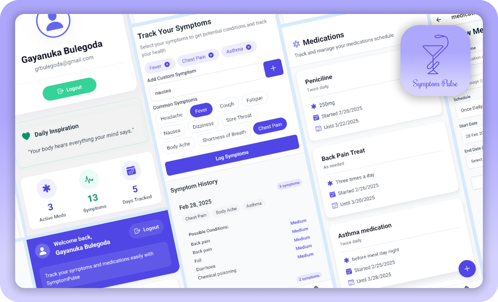
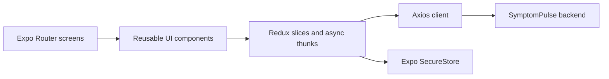

# SymptomPulse · Mobile frontend

A React Native/Expo learning project for symptom logging, medication records, and an in-app notification list. It demonstrates mobile navigation, shared state, and integration with a separate authenticated API.

[Backend](https://github.com/gayanukabulegoda/SymptomPulse-BACKEND) · [Portfolio](https://www.grbulegoda.com)



The preview illustrates the project UI. This is an educational prototype, not a clinically validated diagnostic tool. Any condition labels returned by the backend should not be interpreted as a medical assessment.

## What it demonstrates

- Registration and sign-in screens, profile display, and logout.
- Symptom submission and paginated history.
- Medication entry with dosage, schedule, and dates.
- Display of notification records fetched from the backend.
- Expo Router navigation, Redux Toolkit state, and reusable UI components.
- Token storage using Expo SecureStore and an Axios response interceptor for refresh attempts.

**Stack:** Expo SDK 52, React Native 0.76, React 18, TypeScript, Redux Toolkit, NativeWind, and React Native Reanimated.

## Architecture



| Directory / file | Responsibility |
| --- | --- |
| [app](app) | Auth screens, tabs, profile, medication-entry routes |
| [components](components) | Forms, cards, lists, and common controls |
| [store/slices](store/slices) | Auth, symptoms, medication, and notification state |
| [utils/axiosConfig.ts](utils/axiosConfig.ts) | API client and refresh/error handling |
| [config.ts](config.ts) | Backend host, port, and API version |

## Run locally

### 1. Prepare the tools and backend

Install Node.js/npm and an emulator or compatible Expo client. Start the [SymptomPulse backend](https://github.com/gayanukabulegoda/SymptomPulse-BACKEND) using that repository's database and environment setup first. The mobile app alone cannot provide authenticated data flows.

This repository uses **Expo SDK 52**. The latest Expo Go app may not support it. Use an SDK-compatible client where available, a compatible development build, or plan an SDK upgrade separately. See [Expo's compatibility and upgrade guidance](https://docs.expo.dev/workflow/upgrading-expo-sdk-walkthrough/). A physical iPhone may require a development build rather than an older Expo Go app.

### 2. Install

```sh
git clone https://github.com/gayanukabulegoda/SymptomPulse-FRONTEND.git
cd SymptomPulse-FRONTEND
npm install
```

No dependency lockfile is committed, so installations may resolve different versions within the declared ranges.

### 3. Point the app at your API

Edit [config.ts](config.ts), replacing `Add your IP address here` with the backend host reachable from the device:

```ts
const IP_ADDRESS = '192.168.1.20'; // Example: use your computer's LAN address
const PORT = '5000';
const VERSION = 'v1';

export const API_URL = `http://${IP_ADDRESS}:${PORT}/api/${VERSION}`;
```

| Target | Backend host |
| --- | --- |
| Physical phone | Your computer's LAN IP; connect both devices to the same network |
| Android Studio emulator | Usually `10.0.2.2` for a backend on the host computer |
| iOS Simulator on the same Mac | Usually `localhost` |

Allow local connections to the backend port. An Expo tunnel for the development server does not automatically expose your separate API. Keep backend secrets on the backend; this frontend configuration is not secret storage. Use HTTPS for any remotely hosted API.

### 4. Start Expo

```sh
npm start
```

Other scripts in this repository:

| Command | Purpose |
| --- | --- |
| `npm run android` | Start Expo and open an Android target |
| `npm run ios` | Start Expo and open an iOS target; simulator requires macOS/Xcode |
| `npm run web` | Start the web target; native-module parity is not established |

The launcher scripts do not build a custom native client. If your client cannot open SDK 52, resolve the SDK/client mismatch before investigating app logic.

## Review the main flows

With the backend connected and a test account available:

1. Register or sign in and inspect the profile screen.
2. Submit sample symptoms and load the history.
3. Add a fictional medication record and check its dates and schedule.
4. Open the notification tab to view records returned by the backend.
5. Sign out and confirm the app returns to the authentication flow.

Use fictional data for development. The frontend sends requests to its own backend; it does not call OpenFDA directly.

## Validation and limitations

- `npx tsc --noEmit` checks TypeScript after installation. No test or lint script is defined in this package.
- The notification tab displays server records. This repository does not implement OS-level scheduled or push notifications.
- SecureStore usage means the web target needs separate verification; a web script is not evidence of full browser support.
- The Axios response interceptor handles refresh retries, but there is no general request interceptor attaching the stored token to initial requests. Verify the backend's authentication contract before treating session handling as complete.
- Dependency updates, mobile-device testing, and production authentication hardening remain separate work.

## License and author

[MIT](LICENSE) · [Gayanuka Bulegoda](https://www.grbulegoda.com)
